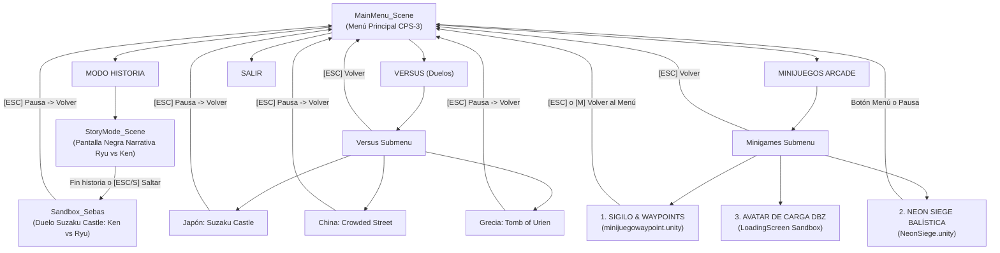

# 🥋 Reporte Técnico de Integración: Minijuegos Arcade, Menú Principal y Modo Historia (Ryu vs Ken)
**Proyecto:** *Street Fighter III: 3rd Strike — Kinet Strike (Unity + Azure Kinect + IA Adaptativa)*  
**Fecha:** 20 de Octubre de 2026  
**Rama de Destino:** `main`  
**Ramas Fusionadas:** `origin/minijuego-waypoint`, `origin/minijuego/lanzamiento-de-proyectil`  

---

## 1. Resumen Ejecutivo y Objetivos Cumplidos

Se ha completado con éxito la integración total de los minijuegos desarrollados en ramas independientes hacia la rama principal (`main`), unificando la experiencia del jugador a través de un **Menú Principal Arcade jerárquico** e implementando el **Modo Historia oficial** con prólogo cinemático en pantalla negra que narra la razón canónica del combate entre Ryu y Ken.

### ✅ Hitos Logrados:
1. **Merge Limpio y Resolución de Conflictos:**
   - Fusión de `origin/minijuego-waypoint` (Minijuego de Sigilo y Evasión con Waypoints y portal Rinnegan).
   - Fusión de `origin/minijuego/lanzamiento-de-proyectil` (Minijuego Neon Siege de balística parabólica en azoteas de Hong Kong).
   - Reconstitución de componentes faltantes (`SpriteFrameAnimator.cs` a 14 FPS).
2. **Menú Principal Unificado e Interactivo:**
   - Creación del submenú **MINIJUEGOS ARCADE** en `MainMenuController.cs` con acceso instantáneo a `minijuegowaypoint`, `NeonSiege` y el minijuego de carga DBZ Tenkaichi.
   - Navegación CPS-3 100% por teclado (`W/S`, `Flechas`, `Enter/Espacio`, `ESC/Backspace`).
3. **Modo Historia con Prólogo Narrativo en Pantalla Negra (Ryu vs Ken):**
   - Desarrollo del componente `StoryPrologueController.cs` y constructor de escena `SF3StoryModeBuilder.cs`.
   - Pantalla negra inmersiva estilo CPS-3 con máquina de escribir, música ambiental de Suzaku Castle y narración del conflicto interno de Ryu (Satsui no Hadou) y la intervención fraternal de Ken.
   - Transición cinemática con fundido a negro y llamada de locutor (*"NOW, FIGHT!"*) hacia el combate en `Sandbox_Sebas`.
4. **Ciclo Completo de Retorno al Menú Principal:**
   - Integración de salida con tecla `ESC` y botones de retorno tanto en el minijuego de Waypoints como en Neon Siege y el duelo de Japón.
5. **Verificación de Compilación:**
   - Compilación por lotes en Unity 6000.3.23f1 con **cero errores** de compilador (`Exit Code 0`).

---

## 2. Auditoría y Fusión de Ramas (Git Merge)

### 2.1. Ramas Integradas
* **`origin/minijuego-waypoint`:**
  - **Concepto:** Minijuego de sigilo donde Ryu debe recoger orbes de energía evadiendo centinelas que patrullan rutas fijadas por un circuito de waypoints, desbloqueando un portal dimensional con shader procedimental Rinnegan.
  - **Assets Clave:** `minijuegowaypoint.unity`, `StealthMinigameManager.cs`, `WaypointCircuit.cs`, `WaypointPatrolNPC.cs`, `RinneganPortal2D.shader`.
* **`origin/minijuego/lanzamiento-de-proyectil`:**
  - **Concepto:** Minijuego arcade *Neon Siege* donde Ryu dispara proyectiles balísticos Hadouken con cálculo parabólico en tiempo real contra objetivos protegidos por escudos Aegis de Urien en las azoteas de Hong Kong.
  - **Assets Clave:** `NeonSiege.unity`, `NeonSiegeGame.cs`, `SiegeBallistics.cs`, `SiegeArcadeHUD.cs`, `SiegeTarget.cs`.

### 2.2. Resolución de Conflictos y Estabilización
Durante el merge de `minijuego-waypoint` se produjeron conflictos de metadatos (`.meta`) en carpetas compartidas (`Materials.meta`, `Scripts/AI.meta`, `Shaders.meta`) y en `05_PROJECT_LIVE_STATUS.md` y `EditorBuildSettings.asset`.
- Se preservaron los GUIDs canónicos de `main`.
- Se consolidó la tabla de scripts y el changelog de `Devs/Context/05_PROJECT_LIVE_STATUS.md`.
- Se detectó la falta de la clase `SpriteFrameAnimator.cs` (usada por `StealthCollectible.cs`, `StealthPlayerController.cs` y `WaypointPatrolNPC.cs`), creándola en `Assets/StreetFighter3_ThirdStrike/Scripts/Loading/SpriteFrameAnimator.cs` a 14 FPS exactos para respetar las convenciones de CPS-3 sin consumo de memoria Garbage Collector.

---

## 3. Arquitectura del Flujo de Navegación

---

## 4. Modo Historia: Prólogo Narrativo en Pantalla Negra (Ryu vs Ken)

### 4.1. Fundamentación Narrativa: ¿Por qué luchan Ryu y Ken?
El usuario solicitó explícitamente:
> *"añade un modo historia al juego principal, que es la pelea entre Ryu y Ken, que sea una explicación al inicio, una pantalla negra con letras dándole una historia a la razón de por qué Ryu y Ken se pelean."*

La narrativa incorporada en `StoryPrologueController.cs` se estructura en 5 actos canónicos dentro de la mitología de *Street Fighter III: 3rd Strike*:

1. **Acto I (El Origen Fraterno):**
   *AÑO 1999. Tras años de riguroso adiestramiento en las solitarias montañas de Japón bajo la tutela del venerable maestro Gouken, Ryu y Ken forjaron un lazo más fuerte que la sangre a través del arte sagrado del Ansatsuken.*
2. **Acto II (Caminos Divergentes):**
   *Al culminar su aprendizaje, sus destinos tomaron rumbos opuestos. Ken Masters regresó a América, alcanzando la cúspide de la fama en los circuitos mundiales. Formó una familia junto a Eliza y celebró la llegada de su hijo Mel, encontrando la plenitud en la calidez de su hogar y la paz.*
3. **Acto III (La Oscuridad del Peregrino):**
   *Por el contrario, Ryu abrazó el sendero eterno del peregrino ('Shugyosha'). Sin hogar, riquezas ni ataduras materiales, recorre el planeta buscando la respuesta a qué significa ser un verdadero artista marcial. Sin embargo, su camino se ha oscurecido: la latente amenaza del 'Satsui no Hadou' —el impulso asesino— susurra en su interior, llenando su espíritu de incertidumbre y temor.*
4. **Acto IV (El Reencuentro en Kioto):**
   *Sintiendo la perturbación en el flujo del Hadou y el aislamiento de su hermano de armas, Ken cruzó los océanos hasta las terrazas del milenario Castillo Suzaku en Kioto. Bajo la luz plateada de la luna llena, Ken no encontró al fiero rival de su juventud, sino a un guerrero paralizado por la duda de su propio destino.*
5. **Acto V (La Razón del Combate):**
   *Ken ajusta sus guantes rojos y enciende las llamas de su Shoryuken con una sonrisa desafiante. Sabe que las palabras vacías no salvarán a Ryu de la sombra; la única forma de reavivar el fuego de su alma es mediante el lenguaje supremo de sus vidas: ¡EL CHOQUE HONESTO Y ABRASADOR DE SUS PUÑOS!*  
   *«¡Ryu! Si tus puños dudan, la oscuridad ganará. ¡Ponte en guardia y muéstrame el verdadero Hadou!»*

### 4.2. Características Técnicas del Prólogo (`StoryPrologueController.cs`)
- **Pantalla Negra Sólida:** Color `RGBA(0.015, 0.02, 0.03, 1.0)` con marcos dorados y cian característicos del CPS-3 arcade.
- **Efecto Máquina de Escribir:** Tipografía fluida a 42 caracteres por segundo con pausas dinámicas en signos de puntuación y SFX retro de confirmación (`Menu_Cursor_Select.wav`).
- **Interacción Ágil:**
  - `ESPACIO / ENTER`: Si el texto está apareciendo, lo autocompleta inmediatamente; si ya terminó, avanza al siguiente párrafo.
  - `ESC / S`: Salto instantáneo directo al combate.
  - `M`: Regreso al Menú Principal.
- **Transición Atmosférica:** Al concluir o pulsar saltar, se reproduce la voz arcade del locutor (*"NOW, FIGHT!"*), se aplica un fundido a negro y se carga la escena de combate `Sandbox_Sebas` en Suzaku Castle.

---

## 5. Integración de Minijuegos en el Menú Principal

### 5.1. Minijuego 1: Sigilo y Waypoints (`minijuegowaypoint.unity`)
- **Objetivo:** Ryu debe recoger los orbes de energía dispersos esquivando las rutas de patrulla de los centinelas para activar el portal Rinnegan y escapar.
- **Retorno al Menú:** Añadido soporte nativo para `KeyCode.Escape` y `KeyCode.M` en `StealthMinigameManager.cs` (`ReturnToMainMenu()`), restableciendo la escala de tiempo a `1f` y cargando `MainMenu_Scene`.

### 5.2. Minijuego 2: Neon Siege (`NeonSiege.unity`)
- **Objetivo:** Campaña de 5 asaltos en los tejados de Hong Kong disparando proyectiles Hadouken con física balística parabólica, control de potencia, ángulo y ventanas de recarga contra los escudos de Aegis y Urien.
- **Retorno al Menú:**
  - En la pantalla de título: Botón dedicado `VOLVER AL MENÚ` con estilo slant arcade.
  - En el menú de pausa (`ESC / P`): Botón `VOLVER AL MENÚ PRINCIPAL`.
  - En la pantalla de victoria o derrota: Botón `VOLVER AL MENÚ PRINCIPAL`.

### 5.3. Minijuego 3: Avatar de Carga DBZ Tenkaichi
- Integrado directamente en la pantalla de carga de transición (`LoadingScreenController.cs` y `LoadingMinigameManager.cs`), permitiendo controlar a Ryu con físicas de salto y puñetazos mientras se persiguen orbes con algoritmos cinemáticos de Merodeo (*Wandering*) y Persecución (*Seeking*) de Craig Reynolds.

---

## 6. Sincronización de Escenas en `EditorBuildSettings.asset`

Todas las escenas han sido indexadas formalmente en el proyecto y en `EditorBuildSettings.asset` para garantizar la ejecución en Builds y en Play Mode:

| Índice | Escena | Ruta en el Proyecto | Propósito |
| :---: | :--- | :--- | :--- |
| **0** | `MainMenu_Scene` | `Assets/StreetFighter3_ThirdStrike/Scenes/MainMenu_Scene.unity` | Menú Principal con submenús de Versus y Minijuegos. |
| **1** | `StoryMode_Scene` | `Assets/StreetFighter3_ThirdStrike/Scenes/StoryMode_Scene.unity` | Modo Historia: Prólogo narrativo en pantalla negra Ryu vs Ken. |
| **2** | `Sandbox_Sebas` | `Assets/StreetFighter3_ThirdStrike/Scenes/Sandbox_Sebas.unity` | Duelo Suzaku Castle (Japón): Ken vs Ryu con BGM y pausa. |
| **3** | `Sandbox_China` | `Assets/StreetFighter3_ThirdStrike/Scenes/Sandbox_China.unity` | Duelo Crowded Street (China): Ryu vs Chun-Li. |
| **4** | `Sandbox_Tomb` | `Assets/StreetFighter3_ThirdStrike/Scenes/Sandbox_Tomb.unity` | Duelo Olympian Tomb (Grecia): Ryu vs Urien. |
| **5** | `minijuegowaypoint` | `Assets/StreetFighter3_ThirdStrike/Scenes/minijuegowaypoint.unity` | Minijuego 1: Sigilo y patrullas con waypoints. |
| **6** | `NeonSiege` | `Assets/StreetFighter3_ThirdStrike/Minigames/NeonSiege/NeonSiege.unity` | Minijuego 2: Balística arcade de proyectiles. |

---

## 7. Instrucciones para Ejecución y Pruebas en Unity

1. **Abrir el Menú Principal:**
   - Cargar y reproducir `Assets/StreetFighter3_ThirdStrike/Scenes/MainMenu_Scene.unity`.
   - Utilizar las teclas `W` y `S` (o Flechas Arriba/Abajo) para navegar y `ENTER` o `ESPACIO` para confirmar.
2. **Probar el Modo Historia:**
   - Seleccionar `MODO HISTORIA (Ryu vs Ken)`.
   - Se abrirá la escena `StoryMode_Scene.unity` en pantalla negra con texto de máquina de escribir.
   - Pulsar `ESPACIO` para avanzar los párrafos narrativos o `ESC / S` para saltar directamente al combate en Suzaku Castle.
   - En el combate, pulsar `ESC` o `P` para abrir el menú de pausa y seleccionar `VOLVER AL MENÚ` para regresar.
3. **Probar los Minijuegos:**
   - En el Menú Principal, seleccionar `MINIJUEGOS ARCADE`.
   - Seleccionar `1. SIGILO & WAYPOINTS (Rinnegan)` para jugar en la escena con waypoints; pulsar `ESC` para salir.
   - Seleccionar `2. NEON SIEGE (Balística 2D)` para jugar en las azoteas de Hong Kong; pulsar `VOLVER AL MENÚ` o `ESC` para salir.
4. **Reconstrucción Automática (Editor):**
   - Desde la barra superior de Unity: `SF3 Tools > Build All Project Scenes` regenerará tanto el Menú Principal como la Escena del Modo Historia con todas sus referencias y sincronizará los Build Settings en 1 clic.

---
*Reporte generado y certificado automáticamente por Antigravity AI Assistant.*
